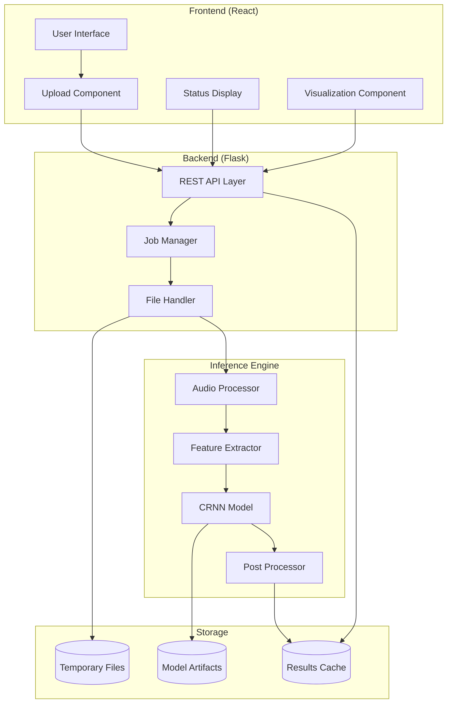
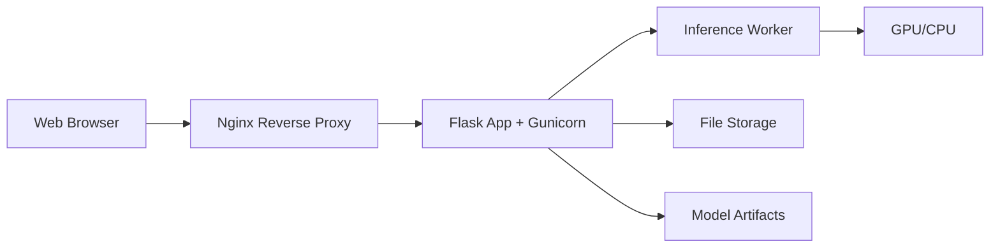

# Design Document: Web Chord Recognition Application

## Overview

This design specifies a web-based chord recognition system that wraps the existing CRNNModel PyTorch implementation with a REST API backend and browser-based frontend. The system enables non-technical users to upload audio files and receive time-stamped chord annotations without installing software locally.

The architecture follows a three-tier pattern: a React-based frontend for user interaction, a Flask REST API backend for request handling, and a PyTorch inference engine for chord prediction. The system leverages existing trained models (CRNNModel_best_model.pth) and preprocessing artifacts (scaler.pkl, label_encoder.pkl) from the current codebase.

Key design decisions:
- Flask backend chosen for simplicity and Python ecosystem compatibility
- React frontend for responsive UI with modern component architecture
- Asynchronous job processing to handle long-running inference tasks
- File-based job storage for simplicity (can be upgraded to Redis/database later)
- Docker containerization for consistent deployment across environments

## Architecture

### System Components



### Technology Stack

**Frontend:**
- React 18.x with TypeScript for type safety
- Axios for HTTP requests
- Recharts for chord timeline visualization
- React Dropzone for file upload UI
- Tailwind CSS for styling

**Backend:**
- Flask 3.x for REST API
- Flask-CORS for cross-origin support
- Werkzeug for secure file handling
- Python 3.11 (matching existing environment)

**Inference:**
- PyTorch 2.5.1 (existing dependency)
- librosa for audio feature extraction
- NumPy/Pandas for data manipulation
- scikit-learn for scaler/encoder loading

**Deployment:**
- Docker for containerization
- Gunicorn as WSGI server
- Nginx as reverse proxy (optional)

### Deployment Architecture



The application can be deployed in three configurations:
1. **Local Development**: Flask dev server with React dev server
2. **Docker Compose**: Containerized Flask + static React build
3. **Cloud Deployment**: Container on AWS/GCP with persistent storage for models

## Components and Interfaces

### Frontend Components

#### UploadComponent
Handles file selection and upload initiation.

**Props:**
- `onUploadComplete: (jobId: string) => void`
- `maxFileSize: number` (default: 50MB)
- `acceptedFormats: string[]` (default: ['.wav', '.mp3', '.flac'])

**State:**
- `selectedFile: File | null`
- `uploadProgress: number`
- `error: string | null`

**Methods:**
- `handleFileSelect(file: File): void`
- `handleUpload(): Promise<void>`
- `validateFile(file: File): boolean`

#### StatusComponent
Displays processing status and progress.

**Props:**
- `jobId: string`
- `pollInterval: number` (default: 2000ms)

**State:**
- `status: 'queued' | 'processing' | 'complete' | 'failed'`
- `progress: number`
- `estimatedTime: number | null`
- `error: string | null`

**Methods:**
- `pollStatus(): Promise<void>`
- `formatTime(seconds: number): string`

#### VisualizationComponent
Renders chord timeline visualization.

**Props:**
- `annotations: ChordAnnotation[]`
- `audioDuration: number`

**State:**
- `scrollPosition: number`
- `zoomLevel: number`

**Methods:**
- `renderTimeline(): JSX.Element`
- `getChordColor(chord: string): string`

**Types:**
```typescript
interface ChordAnnotation {
  startTime: number;
  endTime: number;
  chordLabel: string;
}
```

### Backend API Endpoints

#### POST /api/upload
Accepts audio file upload and initiates processing.

**Request:**
- Content-Type: multipart/form-data
- Body: `file` (audio file)

**Response (200):**
```json
{
  "jobId": "uuid-string",
  "status": "queued",
  "message": "File uploaded successfully"
}
```

**Error Responses:**
- 400: Invalid file format or empty file
- 413: File size exceeds limit
- 500: Server error

#### GET /api/status/{job_id}
Retrieves processing status for a job.

**Response (200):**
```json
{
  "jobId": "uuid-string",
  "status": "processing",
  "progress": 45,
  "estimatedTimeRemaining": 12,
  "message": "Extracting features"
}
```

**Error Responses:**
- 404: Job not found
- 500: Server error

#### GET /api/download/{job_id}
Downloads chord annotation file.

**Response (200):**
- Content-Type: text/plain
- Content-Disposition: attachment; filename="{original_name}_chords.lab"
- Body: Lab file content

**Error Responses:**
- 404: Job not found or results not ready
- 500: Server error

#### GET /api/results/{job_id}
Retrieves chord annotations as JSON for visualization.

**Response (200):**
```json
{
  "jobId": "uuid-string",
  "filename": "song.wav",
  "duration": 180.5,
  "annotations": [
    {
      "startTime": 0.0,
      "endTime": 2.5,
      "chordLabel": "C:maj"
    }
  ]
}
```

### Backend Core Classes

#### JobManager
Manages job lifecycle and status tracking.

**Attributes:**
- `jobs_dir: Path` - Directory for job storage
- `max_concurrent: int` - Maximum concurrent jobs (default: 5)

**Methods:**
- `create_job(file_path: str, filename: str) -> str`: Creates new job and returns job_id
- `get_job_status(job_id: str) -> dict`: Returns job status information
- `update_job_status(job_id: str, status: str, **kwargs) -> None`: Updates job metadata
- `cleanup_old_jobs(max_age_hours: int) -> None`: Removes jobs older than threshold
- `get_active_job_count() -> int`: Returns number of processing jobs

**Job Metadata Structure:**
```python
{
    "job_id": str,
    "filename": str,
    "status": str,  # queued, processing, complete, failed
    "created_at": float,
    "updated_at": float,
    "progress": int,
    "estimated_time": float,
    "error": str | None,
    "file_path": str,
    "result_path": str | None
}
```

#### FileHandler
Handles secure file operations.

**Attributes:**
- `upload_dir: Path` - Temporary upload directory
- `max_file_size: int` - Maximum file size in bytes
- `allowed_extensions: set` - Allowed file extensions

**Methods:**
- `save_upload(file: FileStorage) -> tuple[str, str]`: Saves uploaded file, returns (path, sanitized_name)
- `validate_file(file: FileStorage) -> bool`: Validates file format and size
- `sanitize_filename(filename: str) -> str`: Removes dangerous characters
- `verify_audio_file(file_path: str) -> bool`: Verifies file is valid audio using magic numbers
- `cleanup_file(file_path: str) -> None`: Securely deletes file

#### InferenceEngine
Orchestrates the inference pipeline.

**Attributes:**
- `model: CRNNModel` - Loaded PyTorch model
- `scaler: StandardScaler` - Feature scaler
- `label_encoder: LabelEncoder` - Chord label encoder
- `device: torch.device` - Computation device (CPU/GPU)
- `seq_length: int` - Sequence length for CRNN input

**Methods:**
- `load_artifacts(model_path: str, scaler_path: str, encoder_path: str) -> None`: Loads model and preprocessors
- `process_audio(audio_path: str, job_id: str, callback: Callable) -> list[tuple]`: Runs full pipeline
- `extract_chromagram(audio_path: str) -> tuple[np.ndarray, np.ndarray]`: Extracts chroma features and timestamps
- `prepare_sequences(features: np.ndarray) -> np.ndarray`: Creates sequences for CRNN
- `run_inference(sequences: np.ndarray) -> np.ndarray`: Runs model prediction
- `decode_predictions(predictions: np.ndarray, timestamps: np.ndarray) -> list[tuple]`: Converts predictions to annotations
- `save_annotations(annotations: list[tuple], output_path: str) -> None`: Writes .lab file

**Pipeline Flow:**
```
audio_file → extract_chromagram → scale_features → prepare_sequences → 
run_inference → decode_predictions → save_annotations
```

## Data Models

### Job Metadata
Stored as JSON file in jobs directory.

```python
class JobMetadata(TypedDict):
    job_id: str
    filename: str
    status: Literal['queued', 'processing', 'complete', 'failed']
    created_at: float  # Unix timestamp
    updated_at: float
    progress: int  # 0-100
    estimated_time: float | None  # seconds remaining
    error: str | None
    file_path: str
    result_path: str | None
    audio_duration: float | None
```

### Chord Annotation
Internal representation of chord segments.

```python
@dataclass
class ChordAnnotation:
    start_time: float
    end_time: float
    chord_label: str
    
    def to_lab_line(self) -> str:
        """Formats as .lab file line"""
        return f"{self.start_time:.4f} {self.end_time:.4f} {self.chord_label}"
    
    def to_dict(self) -> dict:
        """Converts to JSON-serializable dict"""
        return {
            "startTime": self.start_time,
            "endTime": self.end_time,
            "chordLabel": self.chord_label
        }
```

### API Response Models

```python
@dataclass
class UploadResponse:
    job_id: str
    status: str
    message: str

@dataclass
class StatusResponse:
    job_id: str
    status: str
    progress: int
    estimated_time_remaining: float | None
    message: str

@dataclass
class ResultsResponse:
    job_id: str
    filename: str
    duration: float
    annotations: list[dict]
```

### File Storage Structure

```
/tmp/chord_recognition/
├── uploads/
│   └── {job_id}/
│       └── audio.{ext}
├── jobs/
│   └── {job_id}.json
└── results/
    └── {job_id}/
        ├── annotations.lab
        └── metadata.json
```

## Correctness Properties

*A property is a characteristic or behavior that should hold true across all valid executions of a system-essentially, a formal statement about what the system should do. Properties serve as the bridge between human-readable specifications and machine-verifiable correctness guarantees.*

### Property 1: Invalid File Rejection

*For any* file that is not a valid audio file (wrong format, corrupted, empty, or oversized), the system should reject the upload and return an appropriate error message indicating the specific validation failure.

**Validates: Requirements 1.4, 1.7, 8.1, 8.2, 8.4, 8.5**

### Property 2: Valid File Acceptance

*For any* valid audio file in WAV, MP3, or FLAC format under 50MB, the system should accept the upload and display the filename and file size.

**Validates: Requirements 1.3, 1.5**

### Property 3: Chromagram Extraction Consistency

*For any* valid audio file, extracting chromagram features should produce a 2D array with shape (n_frames, 12) where n_frames corresponds to the audio duration.

**Validates: Requirements 2.1**

### Property 4: Feature Scaling Normalization

*For any* chromagram feature array, applying the pre-fitted scaler should produce features with approximately zero mean and unit variance (within numerical tolerance).

**Validates: Requirements 2.2**

### Property 5: Label Encoding Round Trip

*For any* valid chord label in the label encoder's vocabulary, encoding the label to an index and then decoding back should return the original label.

**Validates: Requirements 2.6**

### Property 6: Annotation Generation Completeness

*For any* successfully processed audio file, the inference pipeline should generate chord annotations covering the entire duration of the audio with no gaps or overlaps between consecutive segments.

**Validates: Requirements 2.5, 4.1**

### Property 7: Job Status Lifecycle

*For any* job, the status should transition through valid states only: queued → processing → (complete | failed), and once in a terminal state (complete/failed), should not transition to any other state.

**Validates: Requirements 3.3, 3.4**

### Property 8: Processing Time Estimation

*For any* audio file with known duration, the system should provide an estimated processing time that is proportional to the audio duration.

**Validates: Requirements 3.5**

### Property 9: Lab File Format Compliance

*For any* chord annotation, the generated .lab file line should match the format "start_time end_time chord_label" where start_time and end_time are floats with exactly 4 decimal places and start_time < end_time.

**Validates: Requirements 4.2, 4.6**

### Property 10: Output Filename Pattern

*For any* original audio filename, the generated annotation file should be named "{sanitized_original_name}_chords.lab" where sanitized_original_name has all path traversal characters removed.

**Validates: Requirements 4.4, 10.2**

### Property 11: Annotation Preview Accuracy

*For any* completed job with N annotations where N ≥ 10, the preview should display exactly the first 10 annotations; for N < 10, it should display all N annotations.

**Validates: Requirements 4.5**

### Property 12: Visualization Data Consistency

*For any* set of chord annotations, the visualization timeline should position each chord segment at coordinates corresponding to its start_time and end_time, and the total timeline duration should equal the audio duration.

**Validates: Requirements 5.1, 5.2, 5.4**

### Property 13: Chord Visual Distinctiveness

*For any* two different chord types appearing in the same visualization, they should be rendered with different colors or visual markers.

**Validates: Requirements 5.3**

### Property 14: Job ID Uniqueness

*For any* two file uploads (even of the same file), the system should generate distinct job_id values that can be used to track each job independently.

**Validates: Requirements 6.4**

### Property 15: HTTP Error Code Mapping

*For any* request error, the system should return the appropriate HTTP status code: 400 for invalid input (bad format, empty file), 413 for oversized files, 404 for missing resources, and 500 for server-side processing failures.

**Validates: Requirements 6.5, 6.6, 6.7**

### Property 16: Environment Configuration Override

*For any* valid environment variable (MODEL_PATH, SCALER_PATH, ENCODER_PATH, MAX_FILE_SIZE), setting it should override the default configuration value used by the application.

**Validates: Requirements 7.3**

### Property 17: CORS Header Presence

*For any* API response, the response headers should include appropriate CORS headers (Access-Control-Allow-Origin, Access-Control-Allow-Methods, Access-Control-Allow-Headers).

**Validates: Requirements 7.5**

### Property 18: Error Message Sanitization

*For any* error response, the error message should not contain internal file paths, system information, or stack traces that could expose implementation details.

**Validates: Requirements 8.3, 10.6**

### Property 19: GPU Utilization When Available

*For any* system where torch.cuda.is_available() or torch.backends.mps.is_available() returns True, the inference engine should load the model onto the GPU/MPS device rather than CPU.

**Validates: Requirements 9.2**

### Property 20: Request Queuing Beyond Capacity

*For any* state where the number of active processing jobs equals the maximum concurrent limit, new upload requests should be queued rather than rejected, and should begin processing when capacity becomes available.

**Validates: Requirements 9.4**

### Property 21: Temporary File Cleanup

*For any* job that reaches a terminal state (complete or failed) or exceeds the timeout threshold (1 hour), all associated temporary files (uploaded audio, intermediate data) should be deleted from the filesystem.

**Validates: Requirements 9.5, 10.5**

### Property 22: File Content Validation

*For any* uploaded file, the system should verify that the file's magic number (content signature) matches its declared file extension, rejecting files where the extension and content type mismatch.

**Validates: Requirements 10.1**

### Property 23: Filename Sanitization

*For any* uploaded filename containing path traversal sequences (../, ..\, absolute paths), the sanitization function should remove or replace these sequences to produce a safe filename that cannot escape the upload directory.

**Validates: Requirements 10.2**

## Error Handling

### Error Categories

The system handles four categories of errors:

1. **Client Errors (4xx)**: Invalid user input, malformed requests
2. **Server Errors (5xx)**: Internal processing failures, missing resources
3. **Processing Errors**: Model inference failures, feature extraction errors
4. **System Errors**: Missing model files, configuration issues

### Error Handling Strategy

#### Frontend Error Handling

**Upload Errors:**
- Display inline error messages below upload zone
- Provide specific guidance (e.g., "File must be under 50MB" or "Supported formats: WAV, MP3, FLAC")
- Allow user to retry with different file
- Clear error state when new file is selected

**Processing Errors:**
- Show error status in status component
- Display user-friendly error message (sanitized)
- Provide "Try Another File" button to reset state
- Log detailed error to browser console for debugging

**Network Errors:**
- Detect timeout and connection failures
- Display retry button with exponential backoff
- Show offline indicator if network is unavailable
- Cache job_id for retry after reconnection

#### Backend Error Handling

**File Validation Errors:**
```python
class FileValidationError(Exception):
    """Raised when uploaded file fails validation"""
    def __init__(self, message: str, error_code: str):
        self.message = message
        self.error_code = error_code  # e.g., 'INVALID_FORMAT', 'FILE_TOO_LARGE'
```

**Processing Errors:**
```python
class ProcessingError(Exception):
    """Raised when audio processing fails"""
    def __init__(self, message: str, stage: str, original_error: Exception):
        self.message = message
        self.stage = stage  # e.g., 'chromagram_extraction', 'model_inference'
        self.original_error = original_error
```

**Error Response Format:**
```json
{
  "error": {
    "code": "INVALID_FORMAT",
    "message": "Unsupported file format. Please upload WAV, MP3, or FLAC files.",
    "details": null
  }
}
```

### Error Recovery Mechanisms

**Automatic Retry:**
- Transient errors (network timeouts, temporary resource unavailability) trigger automatic retry with exponential backoff
- Maximum 3 retry attempts before marking job as failed

**Graceful Degradation:**
- If GPU is unavailable, fall back to CPU processing
- If visualization fails, still provide download link for .lab file
- If estimated time calculation fails, show indeterminate progress

**Resource Cleanup:**
- Failed jobs trigger immediate cleanup of temporary files
- Cleanup runs even if error occurs during processing
- Use try-finally blocks to ensure cleanup always executes

### Logging Strategy

**Log Levels:**
- ERROR: Processing failures, missing files, invalid configuration
- WARNING: Validation failures, rate limit hits, large file uploads
- INFO: Job creation, status transitions, successful completions
- DEBUG: Detailed processing steps, feature shapes, model outputs

**Log Format:**
```
[timestamp] [level] [job_id] [component] message
2024-01-15 10:30:45 INFO abc-123 InferenceEngine Starting chromagram extraction
2024-01-15 10:30:47 ERROR abc-123 InferenceEngine Failed to load audio: corrupted file
```

**Sensitive Data Handling:**
- Never log full file paths (use basename only)
- Redact user IP addresses in logs (keep first 2 octets only)
- Don't log file contents or audio data
- Sanitize filenames before logging

## Testing Strategy

### Dual Testing Approach

The system requires both unit tests and property-based tests for comprehensive coverage:

**Unit Tests** focus on:
- Specific examples of valid inputs (e.g., uploading a known WAV file)
- Edge cases (e.g., exactly 50MB file, 60-second audio for scrolling)
- Integration points (e.g., API endpoint contracts)
- Error conditions (e.g., missing model file, corrupted audio)

**Property-Based Tests** focus on:
- Universal properties that hold for all inputs (e.g., all valid audio files produce annotations)
- Input space exploration through randomization (e.g., random filenames, various audio durations)
- Invariants (e.g., annotation segments never overlap)
- Round-trip properties (e.g., encode then decode returns original)

### Testing Framework Selection

**Backend (Python):**
- pytest for unit tests
- Hypothesis for property-based tests
- pytest-flask for API endpoint testing
- pytest-mock for mocking external dependencies

**Frontend (TypeScript/React):**
- Jest for unit tests
- React Testing Library for component tests
- fast-check for property-based tests
- MSW (Mock Service Worker) for API mocking

### Property-Based Test Configuration

Each property test must:
- Run minimum 100 iterations to explore input space
- Include a comment tag referencing the design property
- Use appropriate generators for input data
- Verify the property holds for all generated inputs

**Tag Format:**
```python
# Feature: web-chord-recognition-app, Property 1: Invalid File Rejection
@given(st.one_of(
    st.binary(min_size=0, max_size=0),  # empty files
    st.binary(min_size=50*1024*1024+1),  # oversized files
    st.just(b"not an audio file")  # invalid content
))
@settings(max_examples=100)
def test_invalid_file_rejection(file_content):
    # Test implementation
    pass
```

### Test Coverage Requirements

**Backend Coverage:**
- Minimum 80% line coverage for core modules (InferenceEngine, JobManager, FileHandler)
- 100% coverage for security-critical code (file validation, sanitization)
- All API endpoints must have integration tests
- All error paths must be tested

**Frontend Coverage:**
- Minimum 70% line coverage for components
- 100% coverage for file upload and validation logic
- All user interactions must have tests
- Error states must be tested

### Integration Testing

**API Integration Tests:**
- Test complete upload → process → download flow
- Test concurrent job processing
- Test rate limiting behavior
- Test error responses for all failure modes

**End-to-End Tests:**
- Upload real audio file and verify annotation output
- Test UI interactions (drag-drop, button clicks, downloads)
- Test status polling and updates
- Test visualization rendering

### Performance Testing

While not part of functional correctness, performance tests should verify:
- 3-minute audio processes in under 30 seconds (CPU)
- System handles 5 concurrent jobs without degradation
- Memory usage stays within bounds for large files
- Cleanup runs within 5 seconds of job completion

### Security Testing

**Validation Tests:**
- Test path traversal attempts (../../etc/passwd)
- Test magic number spoofing (rename .exe to .wav)
- Test oversized filename attacks (10KB filename)
- Test rate limiting with rapid requests

**Penetration Testing:**
- Attempt to access other users' job results
- Test CORS configuration with various origins
- Verify error messages don't leak sensitive info
- Test file upload with malicious content

### Test Data

**Audio Test Files:**
- short.wav (5 seconds, mono, 22050 Hz)
- medium.mp3 (3 minutes, stereo, 44100 Hz)
- long.flac (10 minutes, stereo, 48000 Hz)
- corrupted.wav (invalid header)
- empty.mp3 (0 bytes)
- oversized.wav (51 MB)

**Expected Outputs:**
- short_chords.lab (known chord progression)
- medium_chords.lab (reference annotations)

**Mock Data:**
- Mock model that returns deterministic predictions
- Mock scaler/encoder for testing without real artifacts
- Mock librosa functions for fast tests

### Continuous Integration

**CI Pipeline:**
1. Run linters (black, flake8, eslint)
2. Run unit tests with coverage reporting
3. Run property-based tests (100 examples each)
4. Run integration tests
5. Build Docker image
6. Run security scans (bandit, npm audit)

**Test Execution Time:**
- Unit tests: < 2 minutes
- Property tests: < 5 minutes
- Integration tests: < 3 minutes
- Total CI time: < 10 minutes

